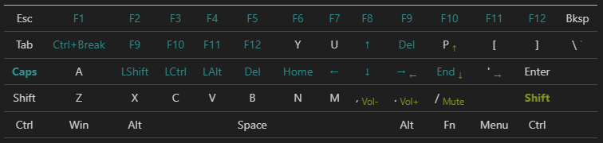

# My Key

This repository contains:
  - A collection of my personal [AutoHotkey (AHK v1.1)](https://www.autohotkey.com/) scripts, in [/scripts](/scripts).
  - HaKey, a C++ application that is implementing _most of_ my AHK Script's functionality, in [/HaKey](/HaKey).

## Layout
A representation of changes in a 60% keyboard (alternative layers are not displayed).

## Scripts (AHK, windows)

List of scripts:

- [`main.ahk`](scripts/main.ahk): The main script that includes all other scripts. I'm using `Task Scheduler` to run this script at user log on.

- [`homeRowNavigation.ahk`](scripts/homeRowNavigation.ahk): Implements custom home row modifiers using `CapsLock` as the main trigger. For example: `CapsLock` key combined with `i`, `j`, `k`, and `l` are remapped to arrows `↑`, `←`, `↓`, and `→` respectively.

- [`stringReplace.ahk`](scripts/stringReplace.ahk): Contains hotstrings for quickly inserting the current date and time in different formats.

- [`60pKeyRemap.ahk`](scripts/60pKeyRemap.ahk): Remaps various keys, designed for 60% keyboards. It remaps common keys used for debugging, text editing, and navigation.

- [`Find mike.ahk`](scripts/Find%20mike.ahk): Displays a list of device input settings.

- [`muteMike.ahk`](scripts/muteMike.ahk): Used to mute the microphone. More information in the script file.

- [`navigationLayer.ahk`](scripts/navigationLayer.ahk): No longer in use, but was used to make custom layers for navigation.

Please note that these scripts are designed for personal use and may need to be adjusted based on your specific needs and keyboard layout.

## HaKey (app)

[HaKey](HaKey/) is a C++ alternative to AHK, supporting Linux and Windows.
See the [HaKey README](HaKey/README.md) for its stack, layers, build commands,
Linux device configuration, and troubleshooting.
